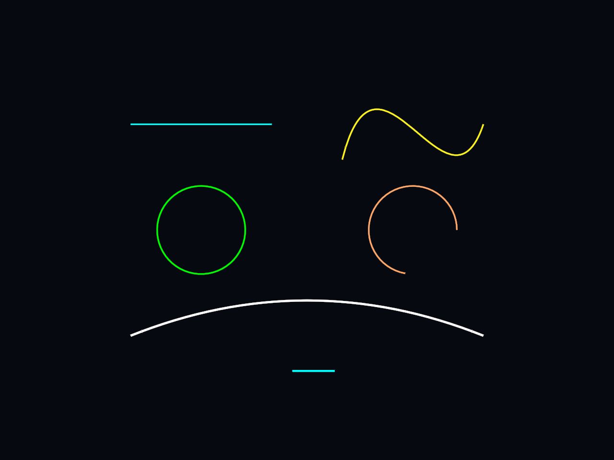

# Unity Lines

Draw world-space lines and curves from C# in Unity, without LineRenderer. A small tool for paths, orbits, connections and tactical overlays.

**Requirements:** Unity 6.0 (6000.0) with Universal Render Pipeline 17. Tested on Unity 6000.0.39f1 / URP 17.0.3, Windows desktop with Direct3D 11. Built-in RP and HDRP are not supported. Other platforms and newer Unity/URP versions have not been validated.



## Install

In Unity, open **Window > Package Management > Package Manager**, choose **+ > Install package from git URL**, and enter:

```text
https://github.com/Zloysvin/Unity-Lines.git
```

Git must be installed and available to Unity. The repository root is the package, so no `?path=` suffix is needed. The URL installs the default branch; for reproducible projects, append `#<commit-hash>` or a published release tag. See Unity's [Git package installation guide](https://docs.unity3d.com/6000.0/Documentation/Manual/upm-ui-giturl.html).

For a local checkout or downloaded ZIP, select **Install package from disk** and choose its `package.json`. This works before the package is published to GitHub. Do not open this repository as a Unity project; install it into an existing URP project.

URP is a declared dependency. Start with a **Universal 3D** project, or configure a URP pipeline asset in your existing project. Installing the package does not switch your project's active render pipeline.

## Try it immediately

Select **Unity Lines** in Package Manager, open **Samples**, and import **Basic Gallery**. Drag the imported `BasicGallery.prefab` into an empty scene and press **Play**. It supplies its own camera and drawer; no material or reference setup is required.

## Draw from code

Attach this component to a GameObject in a scene with a camera tagged **MainCamera**, or assign `targetCamera` yourself:

```csharp
using UnityEngine;
using UnityLines;

public sealed class DrawExample : MonoBehaviour
{
    [SerializeField] private Camera targetCamera;
    private LineDrawing drawing;

    private void Start()
    {
        if (targetCamera == null) targetCamera = Camera.main;
        if (targetCamera == null)
        {
            Debug.LogError("Assign a camera to DrawExample.", this);
            enabled = false;
            return;
        }
        drawing = LineDrawing.Create(targetCamera);

        // Define once; it stays visible until disposed or cleared.
        var circle = drawing.CreatePath(new LineStyle(Color.green, 3), targetCamera.transform);
        circle.Path.SetCircle(new Vector3(0, 0, 10), Vector3.forward, 2, segments: 128);
    }

    private void Update()
    {
        // Visible for this frame. Points here are relative to the camera.
        drawing.DrawLine(new Vector3(-2, -3, 10), new Vector3(2, -3, 10),
            new LineStyle(Color.cyan, 2), targetCamera.transform);
    }

    private void OnDestroy()
    {
        if (drawing != null) Destroy(drawing.gameObject);
    }
}
```

Alternatively, add **Unity Lines > Line Drawing** using **Add Component**, assign its camera and reference it from your scripts. Share a drawer between systems using the same camera. Projects with assembly definitions must add a reference to **UnityLines**.

## What it does

- Straight lines, polylines, cubic/quadratic Beziers, arcs and circles.
- Retained paths (`CreatePath`) and frame-only drawing (`DrawLine`, `DrawBezier`, etc.).
- World or transform-relative points; pixel or world-unit widths.
- Color, alpha, antialiased edges, bounded miter joins, depth testing or overlay.
- Overall **Opacity** slider / `drawing.Opacity`, plus per-path `handle.Opacity` and `style.Opacity`.
- Adaptive curve detail controlled by `PixelError` and maximum segment budgets.
- GPU stroke expansion, cached geometry/uploads and frustum culling; up to two mesh submissions per drawer.
- Bundled shader/material included in player builds, with no manual material setup.

Use retained handles for geometry that does not change every frame. Camera movement usually reuses their meshes; LOD and clipping changes can rebuild them. Editing one path uploads its entire depth-mode batch. Profile your actual scene: large numbers of changing paths and wide overlapping strokes still cost CPU/GPU time.

## Scope

Runtime world-space drawing for standard perspective and orthographic cameras. This version does not provide Scene view previews, fills, SVG import, dashes, round joins, Canvas clipping, XR, or custom oblique projections. Adaptive detail is a centerline error target constrained by the segment budget. Dynamic resolution/upscaling can affect apparent pixel widths.

Read the **[full guide](Documentation~/Guide.md)** for all drawing methods, lifetimes, transforms, LOD, depth behavior and troubleshooting. See **[validation notes](Documentation~/Validation.md)** for the tested configuration and package checks.

## License

[MIT](LICENSE.md).
